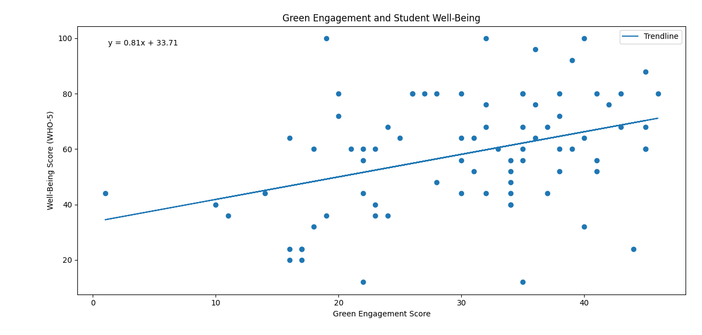
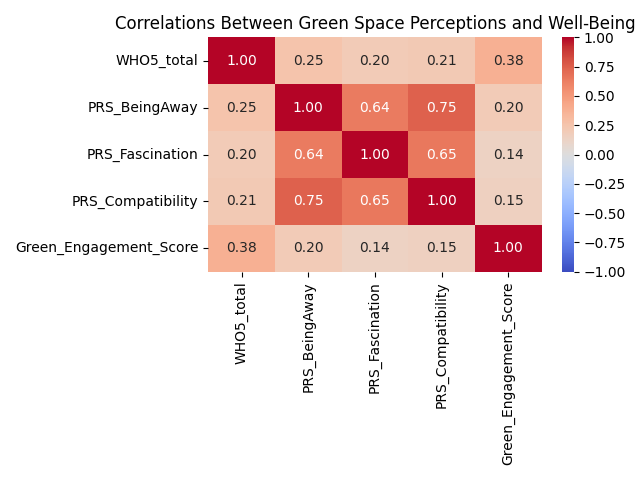
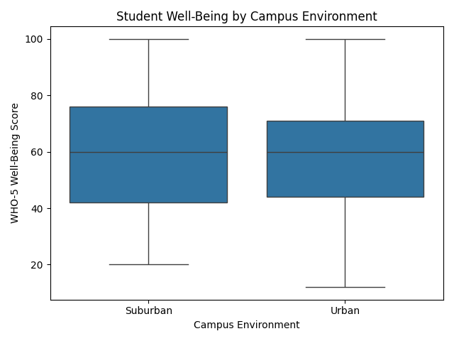
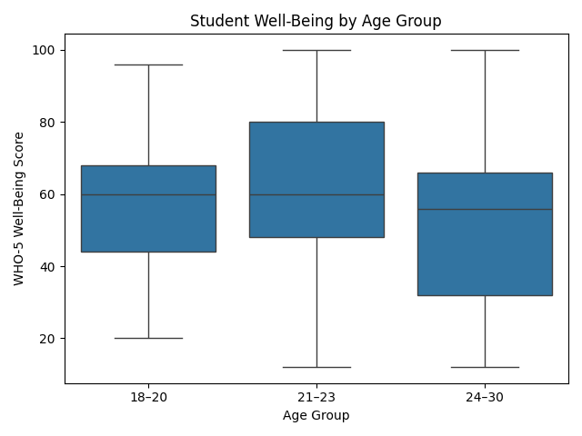
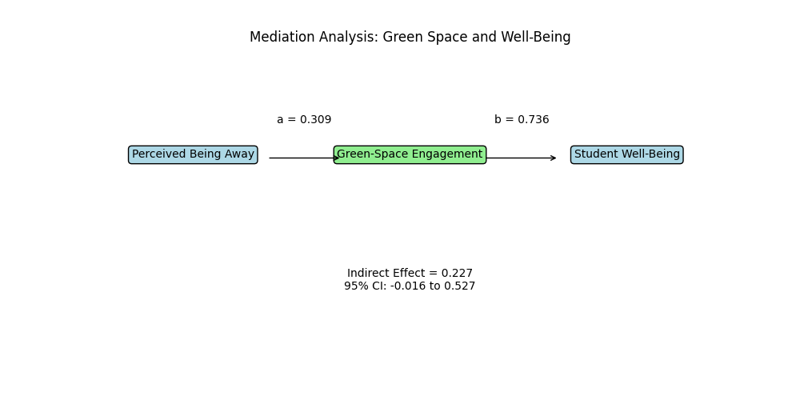

# campus-green-space-analysis
Python analysis of campus green-space perceptions, engagement, and student well-being.

## Project Overview
This project uses Python to investigate the relationship between campus green-space perceptions, engagement with green spaces, and student well-being. The goal was to test the hypothesis: "Students who perceive campus green spaces as providing a greater sense of being away will report higher well-being, with green-space engagement potentially mediating this relationship"

## Research Questions

Are perceptions of campus green spaces associated with student well-being?
Is green-space engagement associated with student well-being?
Does student well-being vary across age groups and campus environments?
Does green-space engagement help explain the relationship between perceived being away and well-being?

## Tools
Tools: Python, pandas, Matplotlib, Seaborn, SciPy, and statsmodels

## Analysis
Data cleaning
Descriptive statistics and correlation analysis
Regression analysis
Group comparisons using t-tests and ANOVA
Mediation analysis with bootstrap confidence intervals
Data visualization

### Mediation analysis

The estimated indirect effect of perceived being away on well-being through green-space engagement was 0.227. The 95% bootstrap confidence interval ranged from -0.016 to 0.527, including zero. Therefore, the analysis did not find statistically significant evidence of mediation at the 5% significance level.

### Limitations
The data are observational, so the results cannot establish cause and effect. Missing responses and the available sample may also limit how broadly the findings can be generalized.

### Visualizations
This repository includes visualizations of the relationships between green-space engagement, student well-being, correlations among study variables, demographic group comparisons, and the mediation model.

### 1. Green Engagement and Student Well-Being

The relationship between students' green-space engagement scores and their WHO-5 well-being scores.
Interpretation: Green-space engagement was positively correlated with well-being (\(r = 0.382,\ p = 0.0004\)).

### 2. Correlation Heatmap

Interpretation: Green-space engagement had the strongest observed correlation with well-being among the variables examined.

### 3. Student Well-Being by Campus Environment

The distribution of WHO-5 well-being scores among students attending urban and suburban campuses.
Interpretation: The t-test did not find a statistically significant difference in well-being between students attending urban and suburban campuses (\(p > 0.05\)). The analysis did not provide sufficient evidence of a difference between the groups.

### 4. Student Well-Being by Age Group

The distribution of WHO-5 well-being scores across the three age groups.
Interpretation: The ANOVA did not find a statistically significant difference in well-being across age groups (\(p > 0.05\)). The analysis did not provide sufficient evidence that average well-being differed among the age groups.

### 5. Mediation Analysis

The proposed indirect pathway between perceived being away and well-being through green-space engagement.
Interpretation: The estimated indirect effect was 0.227, but its 95% bootstrap confidence interval (−0.016 to 0.527) included zero. The mediation effect was not statistically significant at the 5% level.

## Key Findings
Green-space engagement: Positively correlated with student well-being (r = 0.382, p = 0.0004).

Perceived restorativeness: Perceived being away had a positive correlation with well-being (r = 0.252, p = 0.0233). Fascination and compatibility had weaker associations that did not reach the conventional 5% significance threshold.

Mediation analysis: The indirect effect through green-space engagement was not statistically significant because its 95% bootstrap confidence interval included zero.

Limitations: These observational results identify associations, not causal relationships.

